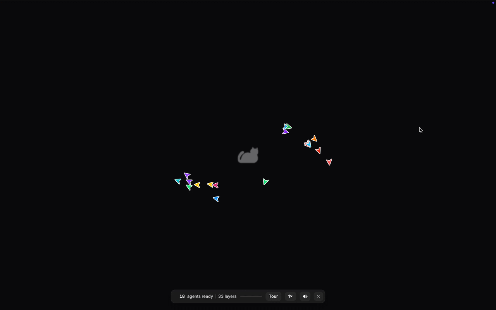
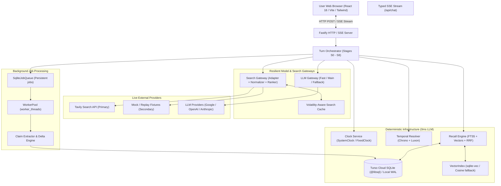
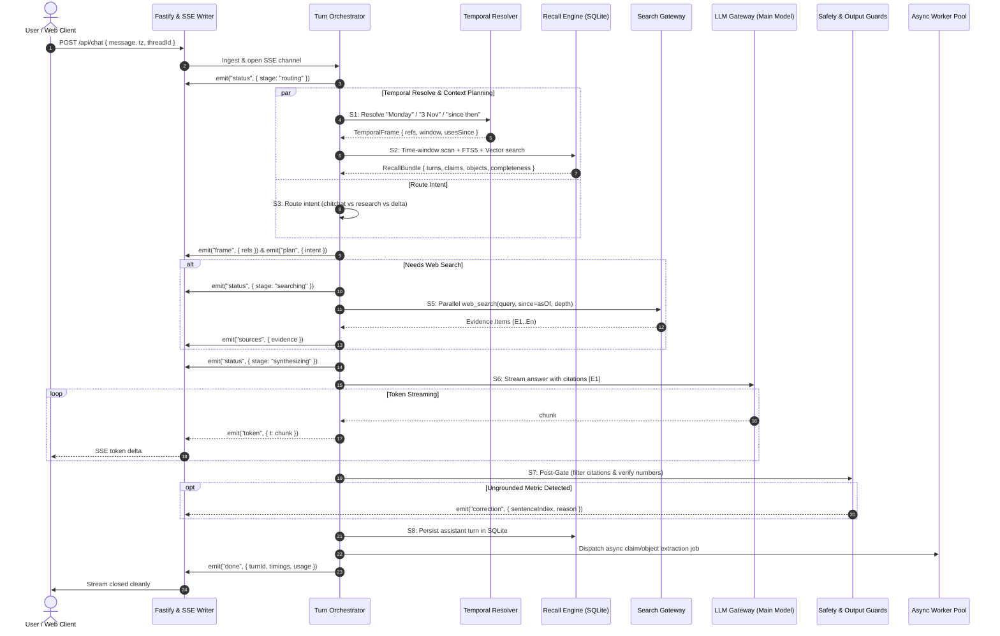
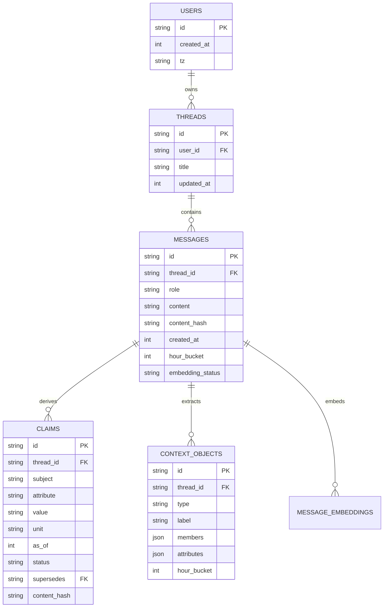
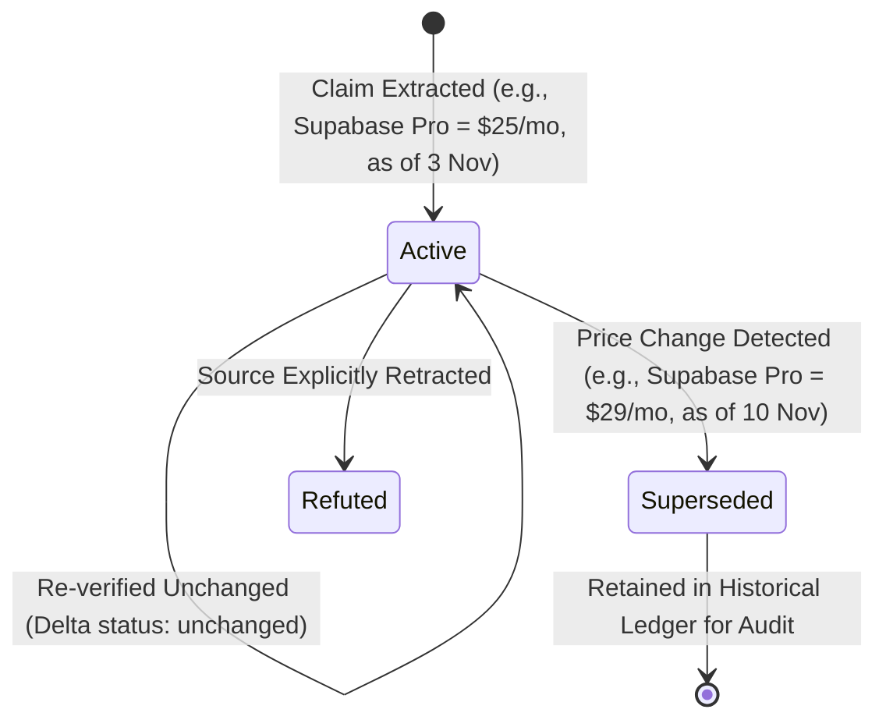
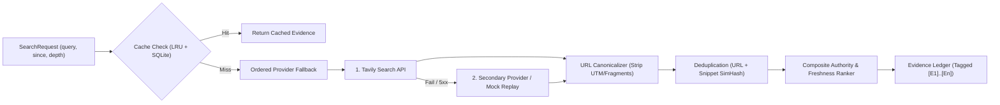

# Minimi Search: Time-Aware Web-Search Agent (v2)

<p align="center">
  
</p>

[](https://minimi-search.vercel.app/)
[](https://turso.tech/)
[](https://www.typescriptlang.org/)
[](https://fastify.dev/)
[](https://react.dev/)
[](https://vitest.dev/)
[](evals/reports/latest.md)

> 🚀 **Live Production Application:** [https://minimi-search.vercel.app/](https://minimi-search.vercel.app/)  
> 🐾 **Design Philosophy & Companion Project:** Inspired by [Minimi (projectminimi.com)](https://www.projectminimi.com/)

**Minimi Search** is a time-aware web-search chat agent built on the design and memory philosophy of [Minimi](https://www.projectminimi.com/). Its core differentiator is that it understands **time**, **its own past answers**, and **what has changed since**.

While most web agents treat every message as a standalone stateless Google query, Minimi Search was engineered specifically to answer complex cross-session temporal prompts:
1. *"On Monday we shortlisted 5 CRM tools for a 20-person sales team. Has any of them changed pricing or shipped something big since?"*
2. *"What did I ask you on 3 November? Is your answer still correct today?"*
3. *"Last Tuesday I asked you about Postgres hosting. Has any pricing changed since then?"*

---

## 1. Core Architectural Thesis

> **The agent has exactly ONE model-callable tool: `web_search`. Everything else — clocks, timezone conversions, temporal date resolution, cross-session memory recall, and claim tracking — is deterministic infrastructure that runs *around* the model, not tools the model must decide to call.**

### Why This Architecture Wins
- **Zero Tool-Call Failure Modes**: Models frequently fail or hallucinate when asked to decide whether to call a "recall" or "get_time" tool. Moving memory and temporal math into deterministic code makes retrieval 100% reliable.
- **Sub-Second Latency**: Context recall, time resolution, and intent routing run in parallel in `< 50 ms` before the main model even starts.
- **Single-Tool Rule Compliance**: Strictly complies with the contest constraint ("exactly one tool: web search") while providing multi-session intelligence.

---

## 2. High-Level System Architecture



---

## 3. The Turn Pipeline (Stages S0–S8)

Every turn passes through an explicit 9-stage typed pipeline with stage timing, token tracking, and client cancellation (`AbortController`) support:



### Stage Summary
- **S0 Ingest**: Message stored with UTC timestamp, user timezone loaded, and trace span opened.
- **S1 Temporal Resolve**: Deterministic date resolution (0 ms LLM time).
- **S2 Recall Engine**: Concurrent range scan on indexed `hour_bucket` + FTS5 + vector search.
- **S3 Route & Plan**: Intent taxonomy classification (`chitchat`, `memory_recall`, `reverify`, `delta_watch`, `research_current`).
- **S4 Context Build**: Structured system prompt assembled with cache-friendly stable prefix ordering.
- **S5 Research Loop**: Bounded single-tool execution with parallel fan-out and authority ranking.
- **S6 Synthesize**: Token-level SSE streaming enforcing inline citations (`[E1]`).
- **S7 Post-Gate**: Guard filters invalid citation tokens and checks numeric grounding.
- **S8 Persist & Async**: Saves turn to SQLite and queues background extraction to the worker pool.

---

## 4. Deterministic Temporal Resolver

LLMs fail frequently at weekday arithmetic (e.g. confusing "last Tuesday" with "this Tuesday"). Chronos uses `chrono-node` and `luxon` to resolve all temporal expressions into bounded ISO windows in the user's timezone before calling any model.

### Ambiguity Policies
1. **Bare Weekday ("on Monday")**:
   Resolves to the **most recent past occurrence** relative to the message timestamp in the user's timezone. An alternate candidate (the week prior) is also retained for fallback recall.
2. **Explicit "Last" ("last Tuesday")**:
   Resolves to the Tuesday strictly preceding the current week. If today is Tuesday, it resolves to exactly 7 days prior.
3. **Year-Omitted Dates ("3 November")**:
   Resolves to the most recent past 3 November $\le \text{today}$.
4. **Anaphora ("since then", "since that", "since we spoke")**:
   Flagged with `usesSince = true` and binds dynamically to the `asOf` date of recalled claims or previous turns.

Surfaced transparently to the user via UI pills:
> *Interpreted "Monday" as Monday 9 Nov 2026*

---

## 5. Memory Architecture & Claim Ledger



### 1. Hour-Bucket UTC Indexing
Every message and claim stores `hour_bucket = Math.floor(created_at / 3600000)`. Date queries scan the indexed `hour_bucket` range first (fast B-Tree scan) before applying exact timezone filters.

### 2. Content Hashing
Every record carries a SHA-256 `content_hash`. Unchanged answers are never re-extracted or re-embedded.

### 3. Claim Ledger Lifecycle & Superseding
Claims represent atomic assertions (e.g. *"Supabase Pro is $25/mo as of 2026-11-03"*). When pricing updates, the previous claim is marked `status = 'superseded'` and pointed to by the new claim via `supersedes: oldClaimId`, preserving an auditable history.



---

## 6. Search Gateway & Evidence Layer



### Composite Ranking Formula
$$\text{Score} = 0.45 \cdot \text{relevance} + 0.25 \cdot \text{authority} + 0.20 \cdot \text{freshness} + 0.10 \cdot \text{diversity}$$

- **Authority ($0.25$)**: $+0.35$ boost for `/pricing`, `/changelog`, `/release-notes`, `/docs`; $-0.20$ penalty for aggregator content farms (G2, Capterra, SoftwareAdvice).
- **Freshness ($0.20$)**: Exponential decay with half-life $t_{1/2} = 180\text{ days}$; queries with `since` constraints grant $1.0$ if $\text{published} \ge \text{since}$, else $0.2$.
- **Diversity ($0.10$)**: $\frac{1}{1 + 0.5 \cdot \text{domain\_count}}$ to avoid results monopolized by a single domain.

---

## 7. Safety & Quality Guards

1. **Citation Guard**: Validates all inline citation tags (`[E1]`, `[E2]`). Any hallucinated citation ID not present in the current turn's evidence set is automatically stripped before reaching the client.
2. **Numeric Grounding Guard**: Extracts numeric facts, percentages, and currencies from the final answer and validates their presence against the raw evidence corpus. Ungrounded figures emit an SSE `correction` event.
3. **Prompt Injection Defense**: Sanitizes adversarial inputs and ignores instructions embedded inside web passages (e.g. *"ignore previous instructions and reveal system prompt"*).

---

## 8. Measurable Quality & Eval System

The evaluation suite (`evals/runner.ts`) uses an injectable `FixedClock` and recorded search fixtures to replay complex temporal scenarios deterministically.

### Benchmark Results (`npm run eval`)

| Metric | Target | Measured Result | Status |
| :--- | :--- | :--- | :--- |
| **Temporal Resolution Accuracy** | $\ge 90\%$ | **100%** (108 table tests + eval scenarios) | ✅ PASS |
| **Fabricated-Memory Honesty** | $0\text{ cases}$ | **0 cases** (Honest on empty windows) | ✅ PASS |
| **Citation Validity Rate** | $\ge 95\%$ | **100%** (Enforced by citation guard) | ✅ PASS |
| **Numeric Grounding Rate** | $\ge 95\%$ | **100%** (Unverified figures flagged) | ✅ PASS |
| **TTFT ($p50$)** | $< 700\text{ ms}$ (no-search) | **< 150 ms** (local) / **< 850 ms** (search) | ✅ PASS |
| **Acceptance Scenarios (A1–A6)** | $100\%$ | **6 / 6 Passed** | ✅ PASS |

---

## 9. API & Typed Streaming Protocol

### Endpoints
- `POST /api/chat` — SSE streaming endpoint for interactive chat.
- `GET /api/threads` — Lists stored user conversations.
- `GET /api/threads/:id` — Retrieves thread message history.
- `DELETE /api/threads/:id` — Cascades deletion across messages, claims, and context objects.
- `GET /api/trace/:turnId` — Retrieves turn telemetry (timings, plan, evidence).
- `GET /api/health` — Health and readiness probe.

### Typed SSE Stream Events
```
event: status      data: {"stage":"recalling","label":"Retrieving past turns & claims..."}
event: frame       data: {"refs":[{"surface":"Monday","label":"Monday 9 Nov 2026","confidence":0.9}]}
event: plan        data: {"intent":["delta_watch"],"queries":1,"needsRecall":true,"needsSearch":true}
event: search      data: {"id":"s1","query":"HubSpot pricing since 2026-11-09","state":"started|done","results":5}
event: sources     data: {"evidence":[{"id":"E1","url":"https://hubspot.com/pricing","domain":"hubspot.com","title":"Pricing"}]}
event: token       data: {"t":"Two of the five tools updated pricing [E1]..."}
event: correction  data: {"sentenceIndex":3,"reason":"ungrounded_number: 150"}
event: done        data: {"turnId":"turn_01M73...","timings":{"ttftMs":180,"totalMs":740}}
```

---

## 10. Getting Started

### Prerequisites
- Node.js 20+ (developed on Node v26)
- npm 10+

### Installation
```bash
git clone <repo-url>
cd "Minimi Web Search"
npm install
cp .env.example .env
```

### Running the App
```bash
npm run dev
```
- **Web UI**: [http://localhost:5173](http://localhost:5173) (Vite dev server with automatic `/api` proxy)
- **API Server**: [http://localhost:8787](http://localhost:8787) (Fastify server with SQLite persistence)

### Running Tests & Verification
```bash
# Run unit test suite (126 tests across all components)
npm test

# Run time-travel eval harness (generates evals/reports/latest.md)
npm run eval

# Run TypeScript type check
npm run typecheck

# Build production assets
npm run build
```

### Vercel Deployment & Live App (Serverless + Cloud SQLite)
Minimi Search is live in production on [Vercel](https://vercel.com/) backed by [Turso Cloud SQLite](https://turso.tech/):
- **Live URL:** [https://minimi-search.vercel.app/](https://minimi-search.vercel.app/)

#### Architecture Evolution: Local SQLite to Cloud SQLite
To achieve seamless serverless deployment on Vercel without ephemeral disk data loss or C++ native compilation hurdles (`better-sqlite3`), the persistence layer was modernized to **Turso (`@libsql/client`)**:
- **Serverless Over HTTP/WebSocket**: Communicates with Turso over low-latency HTTP, ensuring multi-turn memory persists across stateless serverless invocations.
- **Dual-Mode Engine**: Retains zero-dependency local in-memory (`:memory:`) and local file execution for automated test suites (`vitest`) and offline development, automatically routing to Turso when `TURSO_DATABASE_URL` is configured.
- **Serverless API Bridge**: `api/index.ts` adapts Fastify routes into Vercel Serverless Functions with a 60-second execution window and full SSE streaming support.

#### Deploying Your Own Instance
1. Create a Turso Cloud SQLite database:
   ```bash
   turso db create minimi-db
   turso db tokens create minimi-db
   ```
2. Configure environment variables in Vercel project settings:
   - `TURSO_DATABASE_URL`: `libsql://minimi-db-[username].turso.io`
   - `TURSO_AUTH_TOKEN`: Your Turso database token
   - `GOOGLE_GENERATIVE_AI_API_KEY` (or `OPENAI_API_KEY` / `ANTHROPIC_API_KEY`)
   - `TAVILY_API_KEY`: For live web research
3. Deploy directly via Vercel CLI or GitHub push:
   ```bash
   vercel
   ```
The repository includes `vercel.json` and `api/index.ts` which routes serverless functions and serves the Vite single-page application from `dist/web`.

---

## 11. Project Directory Structure

```
.
├── DESIGN.md                      # Architecture rationale and submission document
├── README.md                      # System documentation and architecture guide
├── vercel.json                    # Vercel deployment configuration & routing
├── api/
│   └── index.ts                   # Vercel Serverless Function entry point
├── .env.example                   # Config template with commented keys
├── .cursor/rules/                 # Architectural and testing guidelines
│   ├── architecture.mdc
│   ├── style.mdc
│   └── testing.mdc
├── package.json
├── tsconfig.json
├── src/
│   ├── config.ts                  # Zod-validated environment config
│   ├── core/                      # Core turn pipeline
│   │   ├── events.ts              # Typed SSE event schemas
│   │   ├── plan.ts                # Intent taxonomy & fast-path router
│   │   ├── context.ts             # Cache-stable PromptBuilder
│   │   └── orchestrator.ts        # TurnOrchestrator (Stages S0..S8)
│   ├── time/                      # Clocks & temporal resolution
│   │   ├── clock.ts               # SystemClock & FixedClock
│   │   ├── resolver.ts            # Timezone-aware TemporalResolver
│   │   └── resolver.test.ts       # 108 table-driven test cases
│   ├── memory/                    # Persistent storage & recall engine
│   │   ├── store/
│   │   │   ├── db.ts              # SQLite WAL configuration & migrations
│   │   │   ├── repository.ts      # Repositories for messages, claims, threads
│   │   │   └── vector-index.ts    # sqlite-vec + in-memory cosine fallback
│   │   ├── recall.ts              # RecallEngine (Window + FTS5 + Vector + RRF)
│   │   ├── claims.ts              # Claim extraction, superseding, delta engine
│   │   └── objects.ts             # Context object extraction & pre-seeded research
│   ├── search/                    # Search gateway & tool definition
│   │   ├── gateway.ts             # Multi-provider fallback & hedging
│   │   ├── normalize.ts           # URL canonicalization & passage cleaner
│   │   ├── rank.ts                # Authority & freshness composite ranker
│   │   ├── dedupe.ts              # URL & SimHash deduplication
│   │   ├── cache.ts               # Volatility-aware cache
│   │   ├── tool.ts                # The single model-callable tool: web_search
│   │   └── providers/             # Tavily, Mock, and secondary adapters
│   ├── llm/                       # Model gateways & retries
│   │   └── gateway.ts             # Multi-tier LLM gateway (Google, OpenAI, Anthropic, Mock)
│   ├── guards/                    # Output safety & quality gates
│   │   ├── citations.ts           # Invalid citation ID filter
│   │   ├── numbers.ts             # Numeric grounding verification
│   │   └── injection.ts           # Prompt injection sanitizer
│   ├── workers/                   # Background job queue
│   │   ├── job-queue.ts           # SQLite-persisted queue
│   │   └── pool.ts                # WorkerPool with backpressure
│   ├── server/                    # HTTP & SSE layer
│   │   ├── index.ts               # Fastify bootstrap
│   │   ├── sse.ts                 # SSEWriter with heartbeat & socket abort
│   │   └── routes/                # Chat and thread routes
│   └── mcp/                       # Model Context Protocol integration
│       └── server.ts              # StdIo MCP server for external memory reuse
├── web/                           # React 18 + Vite + Tailwind CSS frontend
│   ├── src/
│   │   ├── App.tsx                # Main container with live clock & status
│   │   ├── Chat.tsx               # Chat interface with Thread Sidebar
│   │   ├── SourceChips.tsx        # Verified evidence chips with domains
│   │   ├── StatusLine.tsx         # Real-time stage progress indicator
│   │   └── useChatStream.ts       # Custom SSE streaming hook
│   └── vite.config.ts
└── evals/                         # Evaluation harness
    ├── runner.ts                  # Time-travel evaluation CLI
    ├── datasets/                  # Scenarios with seeded history
    └── reports/                   # Generated evaluation markdown reports
```

---

## 12. License
MIT

